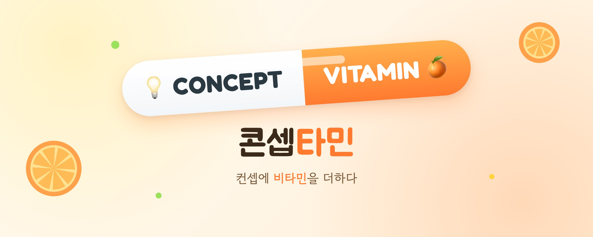
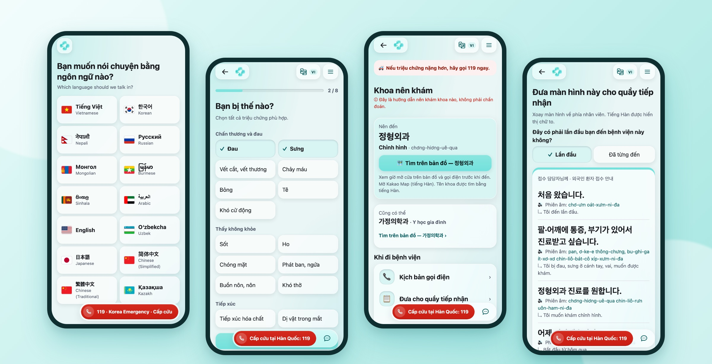
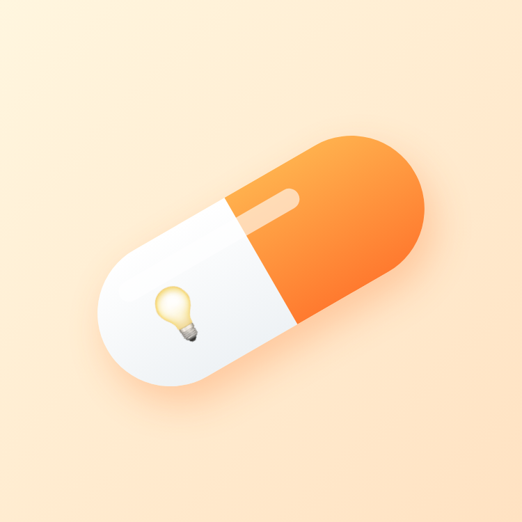

 

**💡 Concept** &nbsp;+&nbsp; **🍊 Vitamin** &nbsp;=&nbsp; **💊 콘셉타민**

좋은 컨셉은 많습니다. 하지만 사람에게 닿기 전에 시들어 버리는 컨셉도 많습니다. 
우리는 컨셉에 **실제로 움직이는 힘** — 비타민 — 을 더해, 쓰는 사람의 하루에 닿을 때까지 만듭니다.

---

## 💊 1정 성분표

> 콘셉타민 한 알에 들어 있는 것. 우리가 일하는 방식입니다.

| 성분 | 함량 | 효능 |
|---|:-:|---|
| 🍋 **Vitamin C** — *Concept* | 1일 권장량 100% | **문제부터 정의합니다.** 누가, 언제, 어디서 막히는지 먼저 적고 그다음에 만듭니다 |
| 🥕 **Vitamin E** — *Empathy* | 1일 권장량 100% | **쓰는 사람의 언어로.** 화면 문구 하나도 그 사람이 읽는 말로 씁니다 |
| 🥛 **Vitamin D** — *Data* | 분자 · 분모 포함 | **숫자로 말합니다.** 측정 전에 성능을 적지 않고, 나쁜 결과도 숨기지 않습니다 |
| 🌰 **Vitamin B** — *Build* | 항목 하나 = PR 하나 | **작게 만들고 바로 보여 줍니다.** 결정은 기록으로, 기능은 동작하는 화면으로 남깁니다 |
| 🛡️ **Vitamin S** — *Safety* | 대체 경로 상시 포함 | **꺼져도 멈추지 않게.** 무엇 하나가 빠져도 사용자가 길을 잃지 않도록 설계합니다 |

※ 본 제품은 의약품이 아닙니다. 과다 복용 시 아이디어가 넘칠 수 있습니다.

## 🧪 첫 번째 처방 — for nav

<table>
  <tr>
    <td width="38%" valign="middle" align="center">
       
      
      <h3>아플 때, 말이 통하지 않아도 길을 잃지 않게</h3>
      울산 외국인 근로자를 위한 <b>다국어 의료 내비게이터</b>
        
      
      
       
      
    </td>
    <td width="62%" valign="middle">
      
    </td>
  </tr>
</table>

| 💡 Concept | 🍊 Vitamin |
|---|---|
| 외국인 근로자는 아플 때 **어느 과로, 어떤 제도로, 뭐라고 말하며** 가야 할지 모른다 | 증상을 **버튼으로** 고르면 진료과 2곳 · 비용 지원 경로 · 접수 문장을 **모국어 + 한국어**로 |
| 지원센터에 연락해도 언어가 맞는 상담사가 늘 있지는 않다 | 요청이 센터 접수함에 바로 도착하고, **번역 채팅 · 번역 자막 통화**로 이어진다 |
| 앱이 응급을 잘못 판정하면 헛된 확신을 준다 | 응급도 모델을 만들고 측정한 뒤 **스스로 지웠다.** 대신 119 버튼을 모든 화면에 고정 |
| 발표장 네트워크가 끊기면 시연이 멈춘다 | 모델 · LLM · DB · 서버 중 무엇이 꺼져도 **대체 경로로 계속 동작** |

  🌏 <b>20개 언어</b> &nbsp;·&nbsp; 🩺 <b>진료과 test Top-2 98.3%</b> &nbsp;·&nbsp; 🔀 <b>PR 200+</b> &nbsp;·&nbsp; ✅ <b>테스트 400+</b>

## 🧰 우리가 쓰는 도구

  
  
  
  
  
  
  
  
  
  

## 👥 콘셉타민 사람들

  

---

**오늘도 컨셉에 비타민 한 알** 💊

콘셉타민 · Concept + Vitamin

